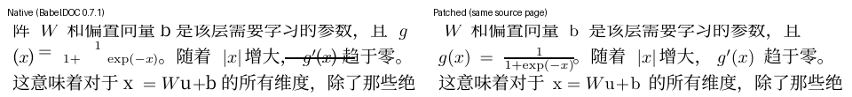
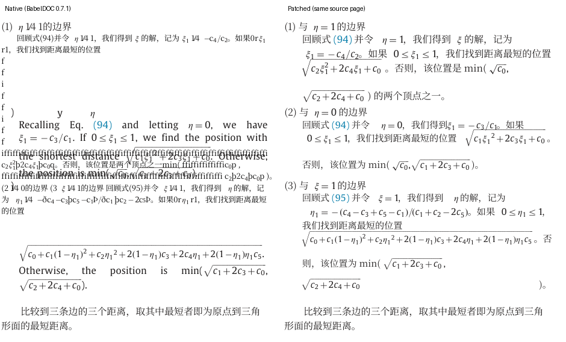

# 数学字体和短分数线兼容模式（实验性，默认关闭）

一些 Advance 数学字体的 ToUnicode 将根号延伸符号提取为 `ffi`。
这类符号进入翻译后会变成乱码；独立斜体变量也可能混入正文。
另外，零高度描边或细长图像蒙版构成的分数线，可能停在原位置，
而公式字符已被重排。本补丁在一次翻译的临时输入上处理这些情况。

## 启用与版本范围

在插件的 PDFMathTranslate-next 设置中勾选“数学公式兼容”即可启用，默认关闭。
直接调用 Server API 时可在翻译请求顶层传入 `"mathCompatibility": true`，
或在服务设置的额外参数 JSON 中添加该字段。顶层值优先，可用 `false` 关闭。
该字段只由服务器读取，不写进翻译服务参数。没有新增默认开启行为。

| pdf2zh-next / BabelDOC | 此模式的行为 |
| --- | --- |
| 2.10.2 / 0.7.1 | Advance/MathType 字体补充、独立变量保护、低置信度正文误判修正、短 TeX 横线转换 |
| 2.9.0 / 0.6.2、0.6.4 | 普通 TeX 文档启用短横线转换及数学专用 CMR 检查；含 Advance/MathType 的文档警告并保留原生处理 |
| 其他组合、Windows 独立 EXE | 保留原生处理并提示未验证 |

0.6.x 的 Advance 根式碎片在测试中仍会错位，因此没有把“成功导出 PDF”
当作视觉回归通过。补丁不会自动升级引擎。自定义 `formular_font_pattern`、
OCR/自动 OCR 模式保留原来的处理方式。

调试入口（从 `server` 目录、使用对应引擎的 Python；沿用自己的有效 TOML）：

```sh
python utils/table_runner.py none --zotero-math-compat paper.pdf --config-file config.toml --pages 2
```

## 实现范围

- 保留已验证引擎的默认字体表达式，仅追加在所选页发现的数学字体。
  必须通过配置传入：0.7.1 的公式分类使用 Rust，修改 Python 辅助函数不会生效。
- 只为 AdvOT 斜体字体中含单个 ASCII 字母的字体片段建立别名，保留嵌入字形、
  度量和文本；完整斜体单词保持原字体。跨 `BT`/`ET` 的字体状态及共享资源不泄漏。
- 对 Advance 文档中置信度低于 0.75、原生文本含明显英文正文的公式区域，
  恢复正文类型，并分隔编号数学情形。旋转页面、高置信度公式和图形保持原分类。
- 只在含 TeX 数学字体的所选页处理短横线。转换条件限制为不超过 72 个局部用户单位、
  长宽比大于 4 的水平实线/不透明单像素蒙版。长框线、虚线、圆端帽、
  透明描边、复合路径及不明确的图像格式保持原样。共享 Form 按调用克隆。
- CMR 字体只有在所有所选页均未检出正文用途时才补充为数学字体。

这是有限启发式，不是通用数学语义识别：单独斜体 `a` / `I` 也可能是英文单词；
变量保护不递归改写 Form 内文本；长分数线不处理。复杂算法框、图内标签、
跨行公式及正文段落布局仍可能存在引擎原有问题。请保持默认关闭并检查结果。

## PR #390 原作者的验证记录

以下为 PR #390 随补丁提供的审计和实译记录，不代表本次合入重新执行了这些实译。

测试于 Windows / Python 3.12，补丁基于 `05f44427cb35c16ca25ab5728518fe5004563285`。

1. 12 篇、197 页的整篇预处理审计：6 篇 Advance 论文共 95 页，
   共保护 2,342 个单字母片段，95 页渲染逐像素一致；全部 197 页提取文本一致。
   其余样本包含 Batch Normalization、Adam 和 4 篇数值分析/有限元论文。
   最终保守范围转换 223 条短横线；像素差异仅在原横线 1pt 邻域内。
   这项整篇审计不等于对 197 页做了完整翻译。
2. 0.7.1：对 10 篇论文的 13 个选定页面分别运行原生和补丁实译，
   包含 Bi & Yang 2014 的第 18 页、Batch Normalization 第 2–5 页、
   Adam 第 3 页，以及 Advance/普通 TeX 对照。检查输出页数及渲染对照。
   MathType/MTExtra 名称另用合成用例检查；未声称每种字体都有真实论文样本。
3. 0.6.2 / 0.6.4：测试原生与补丁后发现 Advance 根式仍有问题，故最终对此类
   输入回退原生；另测 TeX 分数线和第 18 页回退行为。两代 CLI 启动路径实译正常退出。
4. 离线用例覆盖所选页、共享字体/Form、字体状态恢复、重复运行、危险描边跳过、
   自定义表达式、旧版回退、真实 Windows spawn、父进程恢复及 Rust 配置传递。
   也修正现有参考文献测试的 mock 目标，使其在实际 0.6.4 环境中可正确验证。

完整服务器测试结果：0.6.2 和 0.6.4 各运行 149 项，0.7.1 运行 147 项，
均通过；各有 11 项因可选依赖/版本条件跳过。0.7.1 的 13 组实译对照共生成
52 份单语/双语 PDF，均能打开、渲染且只包含所选的一页。
0.6.2/0.6.4 的第 18 页回退结果与原生结果逐像素一致。

可公开获取的样本及 SHA-256 见 [math-compatibility-corpus.json](math-compatibility-corpus.json)。
没有把论文全文、用户配置或 API 密钥加入仓库。

离线测试：

```sh
cd server
python -m unittest discover -s tests -p 'test_math*.py'
python -m unittest discover -s tests
```

预处理审计（不调用翻译 API，原文件不修改）：

```sh
cd server
python tests/manual_math_audit.py paper1.pdf paper2.pdf --output audit.json
```

这些数学兼容模块和初始回归用例改编自
[csukingzq/dsh-pdf-translator](https://github.com/csukingzq/dsh-pdf-translator)，
沿用 AGPL-3.0；默认字体表达式来自 BabelDOC 对应版本。

## 局部视觉对照

Batch Normalization，第 2 页（左：原生；右：补丁）：



Bi & Yang 2014，第 18 页（左：原生；右：补丁，BabelDOC 0.7.1）：


